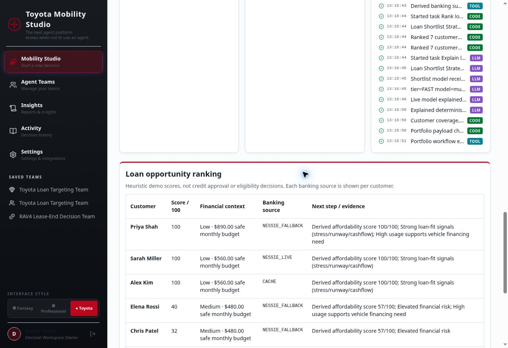

# QuestMaster follow-up QA

**Overall: PASS for the four core demo flows. Exhaustive mobile/tablet and every-control QA remains PARTIAL.**

Continued on `overnight-qa-2026-10-25` in both repositories. The user authorized merge when necessary for application verification. Changes were merged through PRs and deployed by the existing GitHub Actions workflows; no direct production edits, credential changes, migrations or financial-record seeding were performed.

## What changed

1. **Distinct executable portfolio responsibilities.** Mobility loads the installed Toyota demo portfolio, skips no-action customers before banking, derives finance for relevant customers, scores mobility options and ranks urgency. Loan opportunity evaluates all customers and ranks derived financial fit; equal scores are ordered by financial headroom/runway/cash flow rather than fixture order. One LLM call explains deterministic results from minimized summaries. Neither flow submits offers, applications or transactions.
2. **A real planning/runtime permission contract.** Plan-time role descriptions, skills and minimum grants match the chosen workflow. Runtime validates tools, actions, named integrations and the Toyota/financial data scopes actually read, without repairing removed grants or increasing zero budgets. Agent order/IDs do not select the workflow. Fresh plan IDs are server-generated to prevent model-generated ID collisions from overwriting saved definitions.
3. **Reliable save and result handling.** Frontend Save now includes team policy, scope, work style and budgets. Running a draft neither implicitly saves it nor overwrites an existing saved definition. Explicit Save promotes an internal run reference. Portfolio results retain per-customer banking provenance and skipped customers, render on a readable parchment table and survive database hydration through the existing JSON result column, without a schema migration.

The initial report's portfolio/loan limitation is superseded by this follow-up. Its production observations remain a record of the starting state.

## Live verification

| Scenario | Actual result |
|---|---|
| A — `Identify Toyota customers who currently need a mobility decision and recommend the best next step.` | Live Meta planner produced two responsibilities; Run evaluated five relevant customers and skipped Alex/Chris before banking. Jordan/Marcus/Elena received return recommendations; Sarah/Priya buy-current recommendations. One model explanation; actual CODE/TOOL/LLM traces and per-customer provenance. |
| B — `Find the strongest Toyota customers to target for a new vehicle loan.` | Different execution path, all seven customers ranked, no mobility relevance filter or buy/return substitution. One explanation call. Financial-fit tie-breaking uses derived headroom instead of input order. |
| C — no-action customer | Final live run `run-d4888185` returned NO_ACTION_NEEDED with exactly `load_toyota_customer` and `evaluate_mobility_relevance`; zero LLM and no Nessie task. |
| D — recruiting | Live API returned 400 NEEDS_SETUP with `Missing capabilities: ATS, email, calendar`. No fake team execution. Recruiting for Toyota is also covered by regression tests. |
| Removed Nessie integration | Live API returned 400 PERMISSION_DENIED naming the missing `nessie` grant. |
| Removed Toyota vehicle scope | Final live API returned 400 PERMISSION_DENIED naming `vehicle_data` for `load_toyota_customer`, even on a no-action customer. |
| Run without Save | Final live no-action draft was absent from `/teams`; direct saved-team lookup returned 404. |
| Save → open → reload | Browser and live API retained `loan_opportunity`, `portfolio`, work style, team budget and two agents. Tested with the newly generated server-owned team ID `generated-team-90cf0fd6df0e`. |
| Durable run results | After a backend restart, live runs `run-08b0f0cf` (seven-customer loan) and `run-1dd77e2e` (five-customer mobility, two skipped) loaded their full portfolio results and one-call metrics from persistence. |

The final restored-team run `run-7eb24014` completed after the last code deployment: seven loan candidates, Priya Shah first, one LLM call and a 53-word explanation using display names. The saved team's live API response retained `loan_opportunity`, `portfolio`, balanced style, 30-call / $3 team ceilings and two agents (the runtime also enforces server/agent ceilings).

Recruiting was also tested in the browser while a previous team was displayed: the missing-capabilities message persisted, Run and Save were disabled, and the old team was explicitly identified as belonging to the previous plan.

## Tests

- Backend: **102 tests passed**.
- Frontend: **73 tests passed**, 13 test files.
- TypeScript check, production build and diff whitespace checks passed.
- Backend database tests clear the in-memory cache before reloading results, and verify that running unsaved edits cannot overwrite an explicitly saved definition.
- Permission regressions remove tools, financial/Toyota scopes, actions and integration grants. Budget regressions preserve explicit zeros and block the model call. No-action tests use connector/model spies.
- The actual outbound shortlist payload is checked for minimized financial summaries and display names, without raw accounts, purchases, transactions, bank IDs, income rows or fixed-expense rows.
- Frontend tests cover portfolio normalization/rendering, provenance, no-action rows and policy round-trip including explicit zero budgets.

## Merged work and deployment

All code changes remain in the original named branches and were merged using ordinary merge commits; no history rewriting or branch deletion.

- Backend PRs: [#1](https://github.com/eliska-povolna/HackTX2026/pull/1), [#2](https://github.com/eliska-povolna/HackTX2026/pull/2), [#3](https://github.com/eliska-povolna/HackTX2026/pull/3).
- Frontend PRs: [#2](https://github.com/eliska-povolna/hacktx-2026-spark/pull/2), [#3](https://github.com/eliska-povolna/hacktx-2026-spark/pull/3).
- Final backend code head: `4654ed62c58958aaa0a7e96d658bf92df9c1fce6`; main merge `da4786649573ab013175d3eacf80758d850b181c`.
- Final frontend code head: `ae975c62491340b4596766690939a12ad8800945`; main merge `457c4dd85223b07e06ec79d22ed14ed2531a6de1`.
- Final backend deployment: Actions run `40196615456`, **success**. Final frontend deployment: Actions run `40196036631`, **success**.

Report/evidence updates after these deployments are documentation-only changes on the same backend review branch.

## Core product verification

| Claim | Status |
|---|---|
| Knows when not to use an agent | PASS — deterministic relevance stops no-action work. |
| CODE / TOOL / AGENT / LLM separation | PASS — deterministic ranking; one model explanation; real audit events. |
| Planner → workflow coherence | PASS for the installed single-customer and two portfolio workflows. |
| Real permissions; no silent escalation | PASS — named grants and actual data scopes enforced; runtime never repairs. |
| Same Toyota pack supports distinct responsibilities | PASS — mobility urgency vs loan financial fit use different execution paths. |
| Nessie materially affects financial results | PASS for the mapped live scenarios; mixed fixture provenance remains explicit. |
| Multiple customers produce data-driven results | PASS — distinct results and financial perturbation/tie-breaking tests. |
| Unsupported workflow honesty | PASS — recruiting reports missing dependencies before model planning. |
| Run is understandable beforehand | PASS in tested desktop flows, including restored teams. |

## Remaining limits and next actions

- Intent recognition is still constrained by the existing classifier and installed workflow families. This is not arbitrary workflow composition.
- Sarah/Jordan use mapped live Nessie sandbox records. Several other profiles use labeled fixtures; a shared mapped account can be returned as CACHE. The UI does not claim every customer has independently live banking. No duplicate records were seeded.
- Financial-fit scores are transparent demo heuristics, not validated credit-risk or eligibility models.
- Older saved teams with incomplete scopes or previously omitted policy may need re-planning and explicit Save. They are denied rather than silently elevated. Existing records were preserved.
- Mobile/tablet layouts, every dialog/upload and all navigation controls were not exhaustively retested. The portfolio table contains its horizontal overflow; desktop browser workflows were exercised.

Next: use the two exact prompts above in the demo, re-plan any older saved definitions you intend to show, and prioritize a short mobile/tablet pass over adding more integrations.
