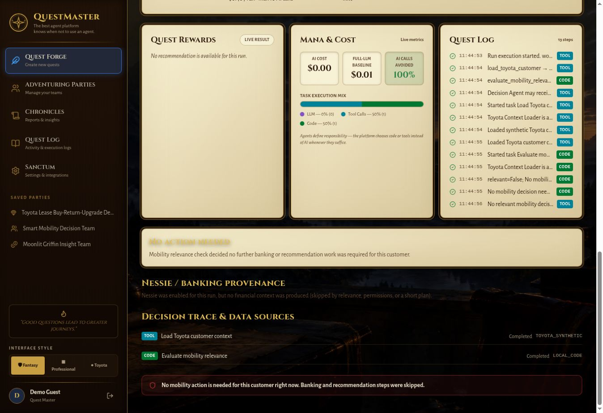

# QUESTMASTER OVERNIGHT QA

> Initial-pass snapshot. The follow-up implementation now completes portfolio mobility and loan ranking; see [follow-up QA](QUESTMASTER_FOLLOWUP_QA.md) for the current status.

**Overall: PARTIAL** — the single-customer mobility demo works, including real Nessie reads and a genuine no-action stop. Portfolio mobility and loan targeting are not end-to-end implemented. This branch makes that limitation explicit instead of executing a different responsibility.

## Branches

- Backend: `eliska-povolna/HackTX2026:overnight-qa-2026-10-25`
- Frontend: `eliska-povolna/hacktx-2026-spark:overnight-qa-2026-10-25`
- Both are review branches. Nothing was merged or deployed; production configuration and financial demo records were not changed.

## Commits

- Backend `2fa187d6367ccade62f800e7169631a04e1b2bd8` — fix runtime permission enforcement and unsupported workflow truthfulness.
- Frontend `2128026219af9c9b8475bc996c055e11da3eaf08` — fix execution expectations and stale planner failure state.
- A following documentation commit contains this report and a production no-action screenshot.

The GitHub connector published the changes because shell Git had no write credentials. The remote code trees were checked against the exact local trees tested: backend `843dcfcdaeea9605998689512bb13648a2d84de7`, frontend `84db5e28066bf51ee4de86e2c2cd2f688e91971a`.

## Starting state and findings

Inspected current main, recent commits, both applications, routing, planner, permissions, normalization, source handling, fixtures, financial derivation and tests. Starting heads: backend `37f9160`, frontend `578dfe6`.

| Priority | Finding | Result on branch |
|---|---|---|
| HIGH | `/api/runs` invoked capability repair before authorization, restoring removed grants. Normalization also added `read` and increased explicit zero budgets. | Fixed: runtime validates the submitted configuration; only planning can align grants. |
| HIGH | An empty integration list meant unrestricted integration access. | Fixed: empty grants authorize no named integrations; actual executed tasks are checked before run creation. |
| HIGH | Loan prompt produced loan-flavored roles but executed the same single-customer mobility pipeline. Portfolio builders/catalog entries lacked corresponding executor handlers. | Honest `NEEDS_SETUP` at planning and run boundaries; full portfolio execution remains unfinished. |
| HIGH | Enabled Toyota context could route unsupported recruiting into Toyota validation. | Capability analysis now rejects unsupported responsibilities before model planning, with missing ATS/email/calendar. |
| MEDIUM | Failed re-planning left a previous team available under the new prompt; the error disappeared with the toast. | Persistent error; Run and Save disabled until successful planning or saved-team reload. |
| MEDIUM | UI called results live even when their banking source was `NESSIE_FALLBACK`. | Fixture banking badge at the result, preserving existing detailed provenance. |
| MEDIUM | No clear pre-run description; source toggles lacked an accessible selected state; customer could change during a run. | Explicit single-customer preview, `aria-pressed`, and locked customer selection during execution. |

## Tested

### Actual production browser flows

Used guest/demo sign-in and the Create form, generated a Toyota team, selected every available customer, ran normal demo executions, inspected recommendations, financial summaries, task traces and audit events. No loans, emails, contracts or financial transactions were submitted.

| Demo/customer | Observed production behavior |
|---|---|
| A: exact portfolio mobility prompt | Planning succeeded, but Run evaluated only the selected customer. It did not scan/rank the portfolio. |
| Sarah Miller | Buy current vehicle; low stress; safe monthly budget $560; `NESSIE_LIVE`; live FAST synthesis. |
| Jordan Lee | Return vehicle; high stress; safe monthly budget $390; `NESSIE_LIVE`; live FAST synthesis. |
| Alex Kim | No action needed; Toyota context + CODE relevance only; zero LLM and no Nessie task. |
| Priya Shah | Buy current vehicle; low stress; safe monthly budget $890; **NESSIE_FALLBACK**. |
| Marcus Nguyen | Return vehicle; high stress; safe monthly budget $0; **NESSIE_FALLBACK**. |
| Elena Rossi | Return vehicle; medium stress; safe monthly budget $480; **NESSIE_FALLBACK**. |
| Chris Patel | No action needed; context/relevance only; no banking or LLM work. |
| B: exact loan targeting prompt | Different role descriptions, but still a buy/return/upgrade mobility recommendation for Sarah. Confirmed wrong-workflow execution, not portfolio targeting. |
| D: exact recruiting prompt | Production returned `NEEDS_SETUP` from Toyota-role validation, suggesting Toyota tools rather than explaining missing recruiting connections. Existing team remained displayed. Confirmed by direct API response as well as browser attempt. |

Also exercised Fantasy/Professional/Toyota interface switches, Activity navigation and its LLM filter, Settings/integration status and team-list navigation. The per-run log preserved ROUTE_DECISION, permission checks, Nessie provenance, data minimization, model selection, LLM calls and evaluator results. The Activity page loaded real recent audit events.

### Branch verification

- `python -m pytest -q backend/backend/tests`: **84 passed**.
- `npm test`: **69 passed**, 12 test files.
- `npm exec tsc -- --noEmit`: **passed**.
- `npm run build`: **passed**.
- `git diff --check`: **passed**.

Tests cover a mocked external planner returning an incomplete/reordered team, plan-time alignment, API execution of that generated team, removed tools/scopes/actions/integration grants, untouched submitted objects, zero team/agent budgets, `BUDGET_LIMIT` with no LLM call, no-action with connector/model spies, unsupported planning without a model call, unsupported direct runs without execution, incompatible team workflow metadata, and the actual minimized LLM request payload. Existing scoring tests change financial context for the same Toyota customer and verify that the recommendation changes.

Test setup now provides explicit test-only model names. The initial unconfigured baseline had 6 failures because model tiers were absent. One stale frontend test expectation omitted `context_source_ids`; it now reflects the existing API contract. Runtime model requirements were not weakened.

## Fixed: root causes and changes

1. **Runtime authorization/budget contract.** Removed execution-time workflow repair, retained plan-time alignment, stopped granting `read` or raising zero budgets during normalization, required explicit named integration access, and checked grants before creating a run. Budget exhaustion now reports `BUDGET_LIMIT`. Regression coverage exercises the public API, not just permission helpers.
2. **Executable responsibility boundary.** Reused existing capability/job analysis before planning and execution. Recruiting reports its missing connections. Loan and portfolio responsibilities explicitly report that their runtime is unfinished. Submitted workflow metadata cannot silently be ignored. This is a conservative truthfulness repair, not a general planner implementation.
3. **User-visible execution contract.** Added a concise conditional preview, honest fixture badge, selected source states, preserved workflow metadata in planning/execution payloads, and persistent failed-planning state. No execution log was moved or replaced.

## Still broken / limitations

- **HIGH: Portfolio mobility and loan targeting remain unimplemented.** Definitions exist, but the executor only supports the single-customer mobility workflow. Branch demos A and B intentionally return `NEEDS_SETUP`; they do not satisfy the originally desired portfolio outcomes.
- **HIGH: Nessie is not live for every listed demo customer.** Priya, Marcus and Elena used fixture banking data in production. Do not present those as live banking demonstrations. No blind seeding or production configuration changes were attempted.
- **MEDIUM: Planning is still constrained by an existing heuristic intent classifier and fixed Toyota workflow.** It is not general capability composition. Attachments inform planning but do not become arbitrary runtime capabilities.
- **Compatibility:** Older saved teams missing explicit actions/integrations may now be denied. Regenerate/review their plan-time grants, then explicitly save; do not restore runtime escalation.
- The separate cloud browser cannot reach the workspace's localhost server (`ERR_CONNECTION_REFUSED`). Branch browser retesting, mobile/tablet layouts, save/reload edits, uploads, all dialogs and every navigation control were **not exhaustively verified**. API tests and build checks are not claimed as browser verification.
- Settings showing an integration as Connected establishes configuration availability, not independent proof of every integration operation or persistence durability. Tiger save durability was not independently verified during this session.

## Core product verification

Statuses below describe the **review branch**, using production observations where code behavior was preserved and local tests where repairs are not deployed.

| Claim | Status | Evidence/limit |
|---|---|---|
| The best agent platform knows when not to use an agent | PASS | Alex/Chris stop after deterministic relevance; connector/model spy regression. |
| CODE / TOOL / AGENT / LLM separation | PASS | Mobility data reads and scoring are separate from language synthesis; real task/audit traces. |
| Planner → workflow coherence | PARTIAL | Supported single-customer generated team validated and executed in tests; broader workflows blocked, not implemented. |
| Permissions are real | PASS | Public API denies missing tool, scope, action and named integration. |
| No silent permission escalation | PASS | Removed runtime grant repair and default `read`; zero budgets preserved. |
| Toyota capability pack supports multiple responsibilities | FAIL | One runnable responsibility; loan/portfolio need implementation. |
| Nessie materially affects financial decisions | PARTIAL | Live Sarah/Jordan split plus same-customer financial perturbation test; other customers use fixtures. |
| Multiple customers produce data-driven outcomes | PASS | Seven live demo runs and scoring perturbation tests; fixture provenance remains explicit. |
| Unsupported workflows fail honestly | PASS | Branch rejects before model/execution; missing recruiting dependencies explained. |
| User can understand what Run will do | PARTIAL | Branch preview added, but not visually retested in cloud browser. |

## Production vs branch

Production still has the behavior observed above, including runtime grant repair, loan-to-mobility substitution and the old result badge. The new authorization checks, responsibility boundary and UI explanations exist only on the review branches. A later reviewed merge/deployment is required; it was not performed.

Use this supported demo prompt after reviewing the changes:

> Recommend the next mobility decision for one Toyota customer using vehicle, lease, usage and financial context.

Then demonstrate Sarah → Jordan → Alex to show live financial impact and a genuine no-action stop.

## Best next actions

1. Review both branches together; run the supported demo on a preview deployment, including removing a permission and testing zero budget, before any merge/deploy.
2. Decide whether to finish portfolio/loan runtime or explicitly limit the HackTX pitch to the working single-customer responsibility. Do not claim the draft catalog proves execution.
3. Use Sarah/Jordan for the live Nessie demonstration and Alex for no-action; separately review any desired additional sandbox records without duplicate seeding.
